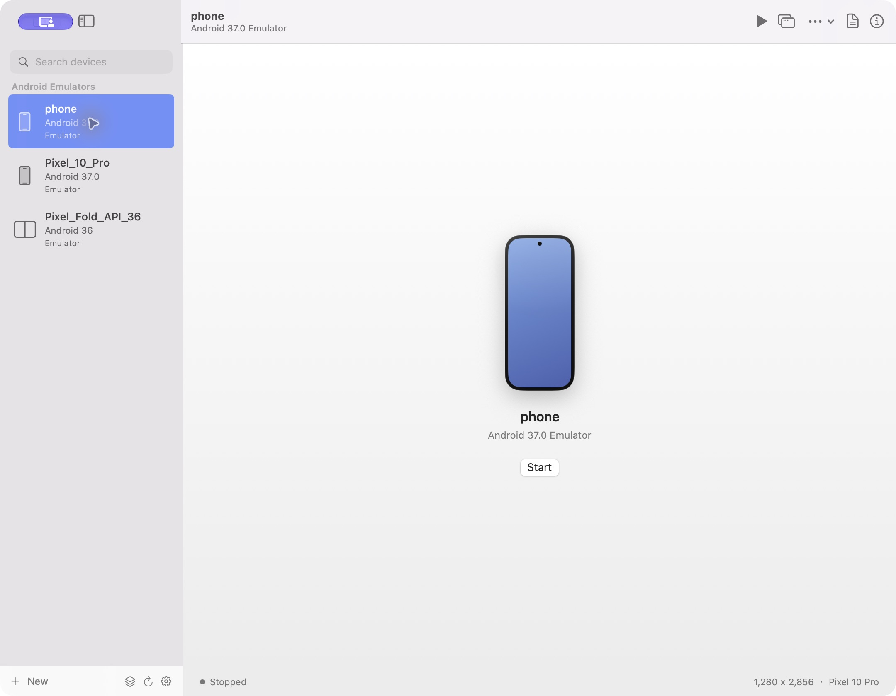

# SimLab

A native macOS app for running Android and iOS simulators in one window. It manages Android AVDs, boots the official Google emulator headlessly, and embeds full CoreSimulator devices in MultiSim.



## What it does

- Lists every AVD in `~/.android/avd` and attaches to emulators that are already running.
- Creates new devices from hardware profiles (Pixel phones, foldable, tablet, watch, TV, Samsung/OnePlus/Xiaomi sizes) and installed arm64 system images.
- Boots `emulator -no-window -grpc <port> -grpc-use-token` and talks to the emulator's gRPC `EmulatorController` directly over HTTP/2 (no adb frame polling).
- Shows the selected emulator in the **main window** with the live screen and a vertical operations toolbar.
- **New → MultiSim** starts with an Android AVD, iPhone 16 Pro, and iPhone Duo. Use the workspace **＋** menu to add another existing or new Android AVD while it is running, and remove optional devices at any time. The workspace scrolls instead of shrinking screens. Screens share a physical scale derived from each simulator's native pixels and display density, so Duo's outer display is shorter than iPhone 16 Pro and its inner display grows when unfolded. Existing TwoSim workspaces migrate to MultiSim with Duo added.
- The iPhone screen is embedded natively with [SimKit](https://github.com/subdiox/SimKit) and CoreSimulator/IOSurface/Metal. Input uses SimulatorKit HID on Xcode 26 and the `dtuhidd` XPC service on Xcode 27. Xcode and an installed iOS runtime are required. This follows [serve-sim](https://github.com/EvanBacon/serve-sim)'s full-device approach; [SimRun](https://github.com/unixzii/SimRun) instead launches one Simulator-built app without the full iPhone system.
- SimKit is vendored under `Vendor/SimKit` (Apache 2.0, upstream commit `74c895e`) with Xcode 27 framework-path fixes. Its small `dtuhidd` bridge follows the MIT-licensed wire format documented by [idb](https://github.com/meta/idb/tree/main/FBSimulatorControl/HID); both licenses are copied into the app bundle.
- MultiSim's Duo **Fold / Unfold** button sweeps the hinge angle with the MIT-licensed [hinge](https://github.com/artemnovichkov/hinge) helper bundled under `Resources/HingeControl`, then confirms the endpoint through CoreMotion. During the sweep, SimLab displays Xcode's `V68.usdz` Duo model with the simulator's current screen image on its panels. The inner framebuffer arrives in portrait pixel order while its UI is landscape, so SimLab rotates the live canvas and chrome together. The hinge helper depends on Xcode's undocumented simulator HID event protocol and may need updating for a future Xcode release.
- Both iPhones have a **Rotate** button in MultiSim. SimLab sends a device orientation event, then rotates its fixed-size IOSurface, device frame, and touch coordinates together. The Duo inner panel's two portrait orientations use opposite framebuffer rotations so the guest's top remains above the home indicator. The device orientation is also refreshed when it changes outside SimLab.
- Duo touch input uses each visible panel's screen ID (1 for the cover, 3 for the inner display in Xcode 27.1). An AppKit hit surface forwards visible screen coordinates to the active digitizer; the SceneKit flip model passes pointer events through to it.
- Each iOS simulator has an optional **Memory** menu. **Reduce Background Services** applies a balanced [SimSlim](https://github.com/MobAI-App/simslim) profile to that device and restarts it; **Restore All Services** returns it to stock. The menu shows its measured process memory. The profile disables Siri, Spotlight indexing, photo analysis, iCloud sync, Mail/Calendar/Contacts background work, device connectivity, telemetry, and other optional services. It keeps push, StoreKit, Universal Links, Apple Account sign-in, photo selection, Files picker Recents, and system sharing available. SimLab never changes these services automatically.
- Android AVDs use a reversible **Balanced** profile by default, including AVDs that already exist and ones created later. On boot, SimLab disables only installed optional system packages: Digital Wellbeing, device restore, Google app/Assistant, Pixel wallpapers, Settings search, YouTube Music, printer suggestions, and the basic screensaver. Google Play services and Store, WebView, notifications, accounts, networking, media selection, location, camera, input, accessibility, and installed test apps stay enabled. AVDs configured above 8 GB start with an 8 GB guest-RAM override when launched by SimLab; the underlying AVD setting is preserved. The Android resource menu switches between **Balanced** and **Standard** and restarts the emulator; Standard re-enables only packages SimLab previously disabled and uses the original RAM setting. The profile changes process usage, not the AVD's user-data disk image or shared system image.
- Each running simulator shows its host CPU use, summed process-memory footprint, and process count. MultiSim samples the host process list once for all visible devices every five seconds; standalone Android windows show the same readings. CPU can exceed 100% when a simulator uses multiple cores.
- The native top toolbar has zoom out / fit / zoom in. The vertical operations toolbar keeps rotate, fold / unfold (foldables), Back / Home / Recents, volume, power, type, APK, apps, screenshot, and stop.
- The main window uses a Device Hub-inspired native workspace: searchable device sidebar, centered device preview, toolbar actions, and collapsible **Info / Session Log** inspectors. Colors follow the macOS appearance.
- Includes the Android SDK tools and installed system images inside the macOS app bundle, and installs APKs through the bundled `adb`.

## Requirements

- macOS 14 or newer (Apple Silicon recommended).
- MultiSim requires Xcode and compatible installed iOS Simulator runtimes. iPhone Duo needs Xcode 27.1 and its iOS 27.1 runtime. SimLab reuses a matching existing simulator or creates one on first use; it does not bundle iOS runtimes.
- Memory optimization uses the bundled arm64 SimSlim CLI. It changes only the selected simulator's background services; system runtimes, installed apps, and Android AVDs are unaffected. Apple features such as widgets, Siri, Spotlight, iCloud sync, Contacts, AirDrop, HealthKit, and FaceTime are unavailable until restored. The profile does not reduce the app's own memory or the Mac-side CoreSimulator rendering services. Actual memory savings depend on the runtime and workload.
- A build made with `build.sh` includes `platform-tools`, `emulator`, `cmdline-tools`, and the locally installed **arm64-v8a** system images.
- Enough free disk: an emulator needs roughly its data-partition size + 3–4 GB. The app refuses to create a device when free space is too low.

The app uses its bundled SDK by default. AVD data stays in `~/.android/avd`. If you choose an external SDK in **SimLab → Android SDK…**, the app also supports fragmented layouts such as:

```text
sdk       = ~/Documents/cmdline-tools/bin
emulator  = ~/Library/Android/sdk/emulator
adb       = ~/Downloads/platform-tools
avds      = ~/.android/avd
```

If auto-detection is wrong, open **SimLab → Android SDK…** and override every path individually.

## Build

```bash
cd ~/Documents/app/AndroidLab
./build.sh release
open build/SimLab.app
```

The build uses Swift Package Manager and fetches SwiftNIO + swift-nio-http2 on the first run. `./build.sh debug` is faster for development. Packaging also copies the installed SDK from `~/Library/Android/sdk` into `Contents/Resources/AndroidSDK`, resolving the existing symlinks to the tools in Documents and Downloads. Set `ANDROIDLAB_SDK_SOURCE` to a different SDK root when building from another machine. The current two system images make the app about 6 GB.

The build also bundles SimSlim v0.14.0 (MIT, source at `Vendor/SimSlim`, tagged commit `7e374b3`). Its official macOS arm64 release archive has SHA-256 `a3db0de6f428f9f8fd5dff256b122f98791c138521dc1330d99643719d8fe9ff`. The pinned binary and `Resources/SimSlim/SimLabBalanced.json` are copied into the app; no Go installation is needed to run or rebuild SimLab on this Mac.

The bundled SDK is treated as read-only so the signed app stays intact. To add or update system images, install them in the source SDK and rebuild, or select a writable external SDK in Settings. SimLab does not redistribute SDK components as part of its source tree.

The bundle mirrors the packages currently installed in the source SDK. That SDK does not yet have Android SDK Platforms or Build Tools, and SimLab does not currently compile APKs; it installs APKs produced by an Android project.

The macOS app icon is built from `Resources/SimLabIcon.svg` ([preview](docs/simlab-icon.png)). After editing it, run `tools/make-icon.sh` to regenerate `Resources/SimLab.icns` before packaging.

## Usage

1. **Start** an existing AVD from the sidebar, or **＋ New** to create one. Choose **MultiSim** first in New to open Android, iPhone 16 Pro, and iPhone Duo together. Use **＋ Add Simulator** in MultiSim to add devices later.
   - For an iPhone in MultiSim, use its **Memory** menu to apply the balanced profile or restore all services. A profile change restarts only that iPhone. The displayed RAM number is the sum of its simulator processes' `phys_footprint`, not disk usage.
2. The emulator boots headlessly. Select it in the sidebar to use its live screen in the main window.
3. Zoom Out / Fit / Zoom In are in the **top toolbar**. The **vertical toolbar on the right** has:
   - Rotate (emulator physical rotation + adb fallback)
   - Fold / Unfold for foldable AVDs
   - Back / Home / Recents
   - Volume − / Volume + / Power
   - Type / APK / Apps / Shot / Stop
4. Use the **Info** or **Session Log** toolbar buttons to show the inspector, and click the same button again or its close button to hide it. Search filters devices by name, Android version, and hardware profile without changing the current selection.
5. **Device → Start / Stop Selected** is `⌘↩`. **Device → Cold Boot** is `⇧⌘↩`.

### Creating a device

- Pick a hardware profile, a name (letters/numbers/dots/dashes/underscores), and an installed arm64 image.
- RAM and storage are applied to `config.ini`; storage defaults to 4 GB for tight disks.
- The app uses the modern `android emulator create` CLI when available, then renames the skeleton AVD and patches it. If that is unavailable it falls back to `avdmanager`.

### System images

**Sidebar → stack icon** opens the image manager. The bundled images are available offline. With a writable external SDK selected, it can install common Android 14–16 Google Play / Google APIs arm64 images with `sdkmanager` and accept the SDK licenses. System images are downloaded from Google.

## How it works

```text
SwiftUI
 ├── AppModel            device list, create/delete, APK install, settings
 ├── DeviceManagerView   main-window workspace + AVD details + log
 ├── DeviceWorkspaceView live canvas + vertical toolbar
 ├── DeviceRuntime       start/stop state machine, boot/rotation polling, reconnect
 └── EmulatorClient      NIO HTTP/2 gRPC client
        ├── streamScreenshot(ImageFormat{RGBA8888})
        ├── parse proto Image{format,image}
        └── CGImage → ScreenSurface (CALayer contents; latest-frame mailbox)
MultiSimWorkspaceView
 ├── Android DeviceWorkspaceView(s) (fixed-size canvases)
 └── SimKit SimulatorScreen(s) (CoreSimulator IOSurface → MTKView, HID input)
AndroidRepository
 ├── sdkmanager / avdmanager / `android emulator create`
 ├── emulator supervisor (free ports, `-grpc`, pid_*.ini discovery)
 └── adb toolbar keys/fallback input, packages, screenshots
```

The emulator writes its gRPC endpoint to:

```text
~/Library/Caches/TemporaryItems/avd/running/pid_<pid>.ini
```

The app reads `port.serial`, `grpc.port`, and `grpc.token` from that file, then sends:

```text
authorization: Bearer <token>
```

to the plaintext HTTP/2 gRPC endpoint. `streamScreenshot` pushes a new frame when the device produces one; frames are decoded to `CGImage` and presented directly as `CALayer.contents`. The frame store updates the AppKit surface directly and asks SwiftUI to lay out only when the frame dimensions change. A latest-frame mailbox prevents stale frames accumulating behind the UI thread. HTTP/2 is configured before TCP starts receiving, so the emulator’s initial SETTINGS cannot be lost.

## Troubleshooting

### “Emulator exited before its control endpoint became available”

Open the device log (the magnifying-glass button in the header) or:

```bash
tail -n 80 ~/Library/Logs/AndroidLab/<avd-name>.log
```

Common causes:

- wrong `ANDROID_HOME` (must contain `platform-tools`, `system-images`, and `emulator`)
- no arm64 system image installed
- not enough free disk space
- stale AVD lock/snapshot

### “The emulator did not respond to the screen stream”

The Android emulator's gRPC screenshot server can get stuck if a previous client was killed uncleanly. Use **Restart Emulator** in the connecting panel, or:

```bash
adb -s emulator-5554 emu kill
```

The app has a 10-second stream watchdog and reconnects automatically. It also asks the emulator to skip snapshot saves (`-no-snapshot-save`) so test runs do not fill the disk.

### Screen clicks

The screen is an `NSView` inside the device frame. Press, drag and release events go immediately through a separate persistent gRPC `streamInputEvent` connection, without waiting for mouse-up to replay a swipe. Coordinates use the displayed aspect-fit area and the panel rotation. Gesture cancellation releases contact on focus loss, rotation, fold and shutdown. Folded screens use the adb compatibility path because some emulator versions normalize secondary-screen gRPC input against primary-screen dimensions. If the input channel is unavailable before a gesture begins, the completed gesture falls back to adb; an uncertain in-flight gesture is never replayed. Toolbar navigation remains on adb for compatibility with AVD keyboard mappings.

### SDK layout

The app bundle contains a standard SDK layout:

```text
<sdk>/
├── cmdline-tools/latest/bin/{android,avdmanager,sdkmanager}
├── platform-tools/adb
├── emulator/emulator
└── system-images/android-36/google_apis_playstore/arm64-v8a/
```

For building the app from a fragmented source SDK, symlinks can provide a standard source layout:

```bash
SDK="$HOME/Library/Android/sdk"
mkdir -p "$SDK/cmdline-tools"
ln -sfn "$HOME/Documents/cmdline-tools" "$SDK/cmdline-tools/latest"
ln -sfn "$HOME/Documents/cmdline-tools/bin/system-images" "$SDK/system-images"
ln -sfn "$HOME/Downloads/platform-tools" "$SDK/platform-tools"
```

## Limitations

- Apple Silicon needs **arm64-v8a** images. x86 images are not supported.
- No audio forwarding, camera preview, or multi-display UI yet.
- Play Store images cannot be `adb root`; use Google APIs images for automation.
- The app is not sandboxed. Spawning the emulator and opening localhost ports is incompatible with the Mac App Store sandbox without an XPC helper.
- The gRPC stream is full-resolution raw RGBA8888 (about 14 MB per 1280×2856 frame). A 2208×1840 Fold at 60 updates/s transfers about 975 MB/s on localhost. Hardware rendering is important; this is not an efficient remote protocol. No resolution reduction or guest animation disabling is applied.
- Screen input is best-effort under synthetic GUI automation; real mouse input uses the same mapping.

## Project layout

```text
Sources/AndroidLab/
├── AndroidLabApp.swift      app entry + menu commands
├── ContentView.swift        sidebar + empty state
├── DeviceDetailView.swift   header, device frame, toolbar
├── ScreenSurface.swift      AppKit screen view + input mapping
├── CreateDeviceView.swift   profile/image picker
├── SettingsView.swift       SDK path overrides
├── ImagesView.swift         system image manager
├── AppsView.swift           installed package launcher
├── AppModel.swift           app state
├── DeviceRuntime.swift      per-device lifecycle
├── EmulatorClient.swift     NIO HTTP/2 gRPC screenshot stream
├── Protobuf.swift           tiny proto encoder/decoder
├── AndroidRepository.swift  SDK/AVD/adb/emulator operations
├── ToolPaths.swift          SDK discovery
└── Shell.swift              process runner
Sources/Probe/                diagnostic gRPC frame grabber
```

`swift run probe emulator-5554` connects to a running emulator's gRPC endpoint and saves `/tmp/probe-frame.png`; it is useful when debugging the frame path.

## Credits

The Android robot is reproduced or modified from work created and shared by Google and used according to terms described in the [Creative Commons 3.0 Attribution License](https://creativecommons.org/licenses/by/3.0/). The icon uses the [Android robot asset](https://developer.android.com/distribute/marketing-tools/brand-guidelines) provided by Google. Android is a trademark of Google LLC.

The protocol used here is Google's public Android Emulator gRPC API (`emulator_controller.proto`, shipped in `$ANDROID_HOME/emulator/lib`). SimLab is an independent client; it does not include or redistribute the Android Emulator or system images.

## Performance validation

The November 2026 performance changes and repeatable measurements are recorded in [the performance report](docs/performance-2026-11-08/REPORT.md). Run regression checks with `swift test`. To collect opt-in local frame/input counters, launch the built executable with `ANDROIDLAB_PERF=1`; normal launches do not record these counters.

### Fold state synchronization

Fold/Unfold reads Android’s actual posture on reconnect and refresh. A toggle chooses its target from a fresh read, resolves supported CLOSED/OPENED IDs, awaits the emulator console’s physical fold/unfold acknowledgement, then changes the toolbar state only after Android confirms the posture. The control and canvas are blocked during the transition; failures show an error instead of a false success label. See [the regression record](docs/fold-fix-2026-11-09/REPRODUCTION.md).
